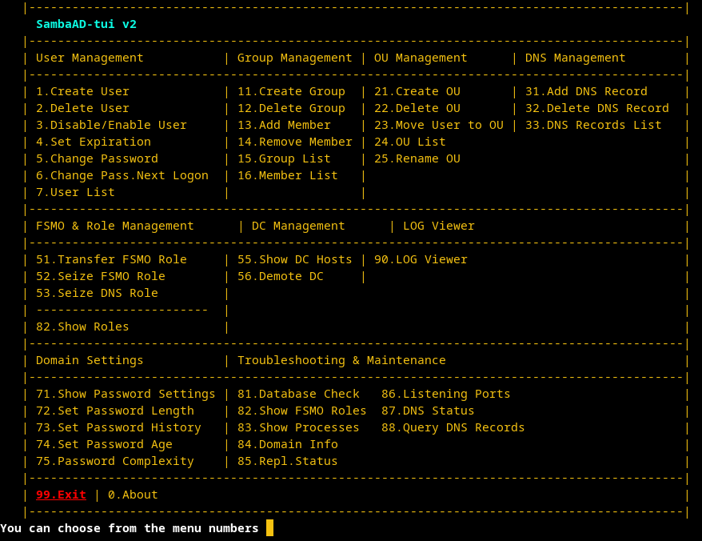

# Samba Active Directory - Terminal User Interface
SambAD-TUI, provides a Terminal User Interface for Samba Active Directory.
<br> This application in used on the Active Directory Server.

SambAD-TUI, does not install Active Directory. You can run on the existing installation. (e.g.DC1)<br>
[For a new Samba AD installation](https://github.com/eesmer/SambaAD-HelperScripts/blob/main/pages/SambaActiveDirectory-Installer.md)

You can look at the DebianDC repository for Active Directory setup and management via GUI.<br>
If you are interested in this topic; you can have a look at [DebianDC](https://github.com/eesmer/DebianDC)

## v3.1
- A new script file has been created for Version 3.
- Version 3 now integrates with `fzf` interfaces.
- The Version 3 script should be used instead of the Version 2 script.
- This version introduces new reporting features, including checks for SYSVOL and GPO.

---

## Features
- User Management
- Group Management
- DNS Management
- FSMO and DNS Role Management
- DC Management
- Settings (password length,complexity,age)
- Maintenance and Troubleshooting (SYSVOL, GPO check and configuration etc.)

---

---

## Requirements
It works in Debian environment. Desktop environment is not required.

## Installation and Usage
```sh
wget https://raw.githubusercontent.com/eesmer/sambad-tui/master/sambadtui-v3.1.sh
```
```sh
bash sambadtui-v3.1.sh
```
Use sambadtui with root user
